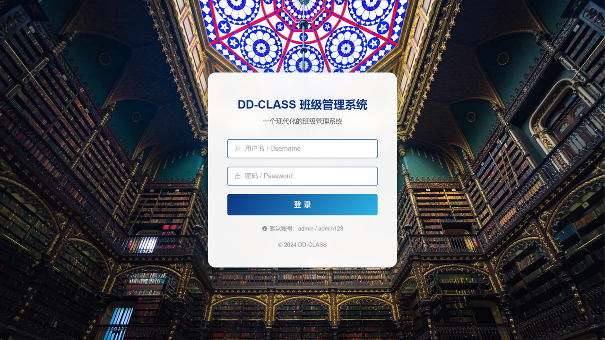
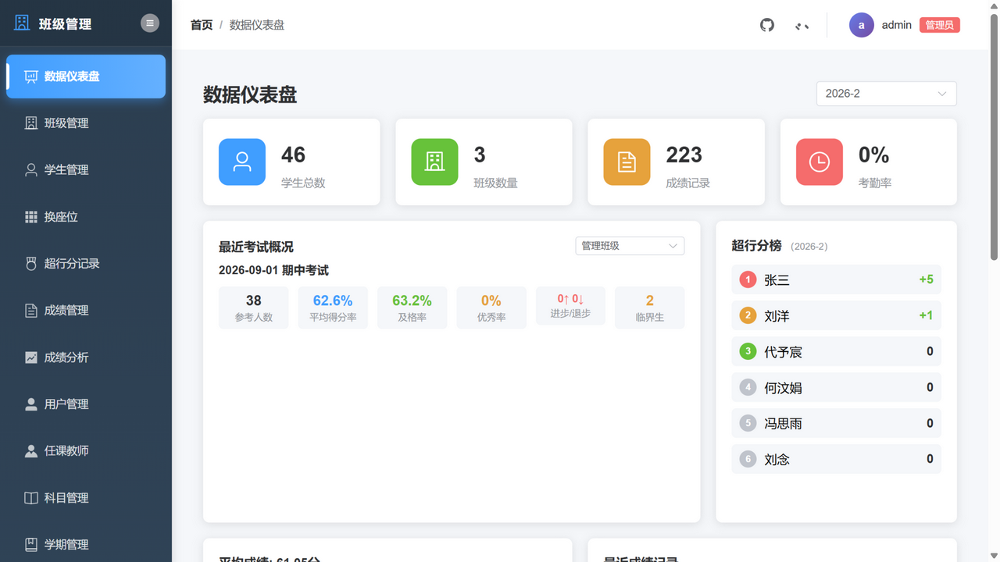
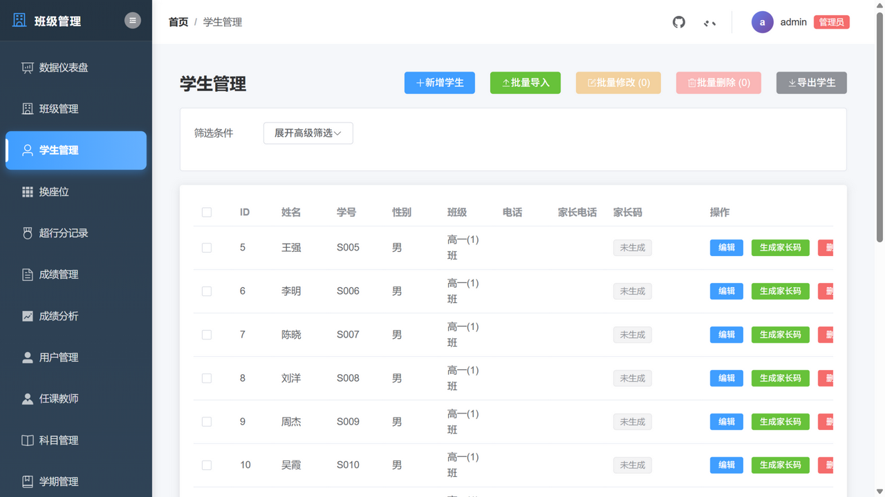
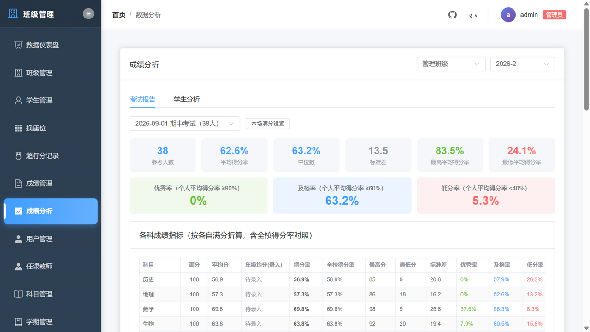
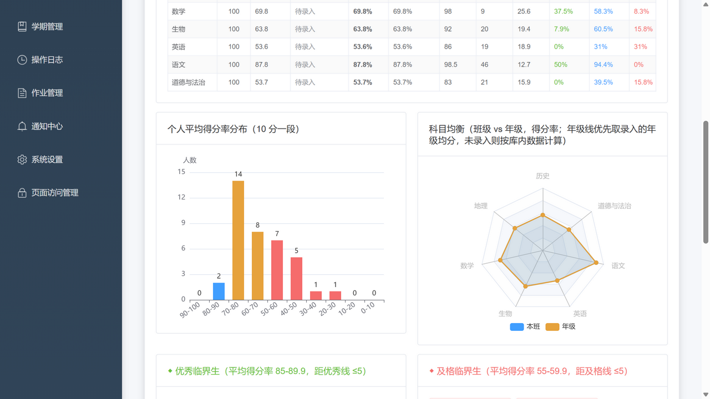
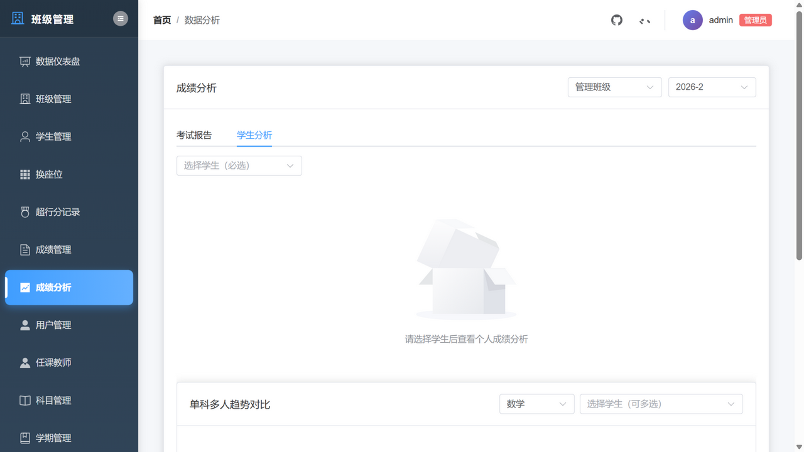

# DD-CLASS 班主任工作台

[](https://www.python.org/)
[](https://fastapi.tiangolo.com/)
[](https://vuejs.org/)
[](./LICENSE)

**面向班主任日常工作的班级管理系统** —— 学生/成绩/考勤/座位/德育/积分一站式管理，深度成绩分析，家长免登录查询端口。本地/局域网部署，数据自主可控。

> 基于开源项目 [joyapple/DD-CLASS](https://github.com/joyapple/DD-CLASS) 的深度二开定制版（遵循 Apache-2.0，同样开源免费）。

---

## 界面预览

| 登录 | 数据仪表盘 |
|---|---|
|  |  |

| 学生管理 | 考试报告（成绩分析） |
|---|---|
|  |  |

| 考试报告图表区 | 学生分析 |
|---|---|
|  |  |

---

## 功能一览

### 基础功能
- **用户认证与权限**：JWT 登录；管理员 / 班主任 / 任课教师三角色，班级数据隔离，操作日志
- **学生管理**：档案、班级内唯一学号、Excel 批量导入导出、批量修改/删除、8 位家长码
- **成绩管理**：录入/导入（按考试类型筛选）、按条件**一键批量删除**历史成绩（实时条数预览 + 二次确认）
- **科目满分体系**：三层满分配置（科目默认 → 科目×考试类型默认 → 场次实例可改）；录入/导入按满分校验；及格线=满分 60%
- **年级均分参照**：一键录入学期/考试类型/日期/科目的年级平均分（联考场景），成绩管理与成绩分析处处参照
- **考勤管理**：出勤/缺勤/迟到/请假、日历视图、全班批量登记、Excel 导入导出
- **作业与通知**：按班级/科目布置作业，**截止状态一目了然**（进行中/即将截止≤24h/已截止/已归档标签+剩余时间），检查完成后一键归档（可取消），默认列表只看未归档；全校/班级通知、置顶与已读管理
- **家长端口**：家长凭 8 位码免装 App 免注册，手机端查孩子成绩/作业/通知/考勤

### 二开定制功能 ✨
- **换座位**：可视化拖拽排座、随机排序、Excel 导入导出、历史座次存档（历史日期只读）
- **超行分记录**：汇总 + 明细双表，汇总恒等于明细分值之和（后端自动重算）
- **任课教师管理** / **班级科目配置**（授课与成绩相关独立开关）
- **数据仪表盘**：学生/班级/成绩/考勤概览、最近考试概况（得分率/三率/进退步/临界生+各科得分率图）、超行分榜、**最近未归档作业**（带截止状态）、最近成绩记录
- **页面访问管理**：按角色灰度隐藏/恢复页面
- **成绩分析**（与成绩管理筛选联动跳转）：
  - **考试报告**：核心指标（中位数/标准差）、优秀/及格/低分三率、各科满分与得分率（含录入的年级均分对照）、得分率分段分布、科目均衡雷达图（班级 vs 年级）、全员名次与**进退步对照**、单科名次、**临界生名单**（提优补差）、本场满分设置
  - **学生分析**：班级排名趋势（可多选考试）、单科分析、薄弱科目（按得分率）、单科多人趋势对比

### 安全加固
SECRET_KEY 弱密钥拒启 ｜ 家长端/登录接口双层限流（防暴力枚举）｜ 公开注册收归管理员 ｜ 重置密码随机化 ｜ CORS 白名单

### 工程化
Alembic 数据库迁移（启动自动接入）｜ 统一权限模块 ｜ pytest 回归测试（35 用例）+ 全模块 API 冒烟脚本（60 项检查）｜ 千行页面组件化拆分

---

## 快速开始（零依赖体验，4 步）

默认使用 **SQLite 免安装数据库**，clone 后 5 分钟跑起来：

```bash
# 1. 克隆并安装后端依赖
git clone https://github.com/mel12ancholy/Teacher-Desk.git
cd Teacher-Desk
python -m venv .venv
.venv\Scripts\activate            # Windows（Linux/Mac: source .venv/bin/activate）
pip install -r requirements.txt

# 2. 启动后端（首次运行自动生成 .env：SQLite + 随机密钥 + 自动探测本机 IP）
python run.py

# 3. 启动班主任端（新终端）
cd frontend && npm install && npm run dev

# 4. 启动家长端（新终端）
cd parent-portal && npm install && npm run dev
```

> 种子数据说明：首次启动会初始化演示账号、班级与 13 个标准科目；示例学生成绩种子文件含真实学生信息，**未包含在仓库中**，克隆部署会自动跳过（不影响使用），可通过「学生管理 → 批量导入」录入自己的学生名单。

| 入口 | 地址 | 默认账号 |
|---|---|---|
| 班主任端 | http://localhost:3000 | `admin / admin123`（管理员）、`teacher1 / 123456`（班主任） |
| 家长端 | http://localhost:5174 | 学生家长码（班主任端「学生管理」生成） |
| API 文档 | http://localhost:8001/docs | Swagger UI |

> ⚠️ 首次部署后请尽快修改默认密码（右上角头像 → 个人中心）。
> 种子数据（幂等）：演示班级、13 个标准科目、示例学生与成绩。

### 生产环境建议（PostgreSQL）

SQLite 适合个人体验与单机使用；多人同时使用建议 PostgreSQL：

```sql
CREATE DATABASE ddclass;
```

编辑 `.env` 中 `DATABASE_URL` 为 `postgresql://用户名:密码@127.0.0.1:5432/ddclass`，重启 `python run.py` 即自动建表迁移。

局域网访问：其他设备访问 `http://<SERVER_IP>:端口`（`.env` 的 `SERVER_IP` 换网络后修改即可；Windows 防火墙放行 8001/3000/5174）。

---

## 系统组成

| 组件 | 技术栈 | 端口 |
|---|---|---|
| 后端 API | FastAPI + SQLAlchemy 2.0 + Pydantic v2 | 8001 |
| 班主任端 | Vue 3 + Element Plus + Vite + Pinia + ECharts | 3000 |
| 家长端 | Vue 3 + Element Plus + Vite | 5174 |
| 数据库 | SQLite（默认）/ PostgreSQL 14+（生产建议） | — |

三个服务的地址、端口、数据库连接统一配置在根目录 `.env`（`python run.py` 首次运行自动生成）。

## 项目结构

```
DD-CLASS/
├── app/                        # 后端（FastAPI）
│   ├── routers/                # 20 个 API 路由模块
│   ├── models.py               # ORM 模型
│   ├── scoring.py              # 满分三层解析与得分率口径
│   ├── ratelimit.py            # 家长端/登录限流
│   └── permissions.py          # 统一角色权限
├── frontend/                   # 班主任端（Vue 3）
│   ├── src/views/              # 页面
│   ├── src/components/         # 弹窗/图表子组件
│   └── src/composables/        # 组合式函数
├── parent-portal/              # 家长端（Vue 3）
├── alembic/                    # 数据库迁移
├── tests/                      # pytest 回归测试
├── tools/smoke_full_api.py     # 全模块 API 冒烟脚本
├── run.py                      # 一键启动（自动初始化 + 可选 cpolar 公网隧道）
└── docs/                       # 部署指南 / 设计方案 / 截图
```

## 常见问题

**登录提示 500 / bcrypt 报错？** `pip install bcrypt==4.0.1`

**端口被占用？** `netstat -ano | findstr :8001` 后结束残留进程；Windows 下多个 uvicorn 残留会路由异常。

**改了 .env 不生效？** `.env` 在启动时读取，需完全重启（`--reload` 只监视 `.py`）。

**启动报「SECRET_KEY 未配置」？** 安全守卫生效：直接 `python run.py` 会自动生成含随机密钥的 `.env`；手动配置时报错信息中附带了可直接使用的随机密钥。

**家长端提示「访问频繁」？** 家长码暴力枚举防护被触发，等 1～15 分钟自动解除。

更多（数据库、API 清单、公网临时访问、全部 FAQ）见 **[docs/部署指南.md](./docs/部署指南.md)**。

## 使用许可

Apache License 2.0，与原项目 [joyapple/DD-CLASS](https://github.com/joyapple/DD-CLASS) 一致：允许自由使用、修改和分发，商业使用请注明原作者出处。

---

*Made with ❤️ based on [joyapple/DD-CLASS](https://github.com/joyapple/DD-CLASS)*
